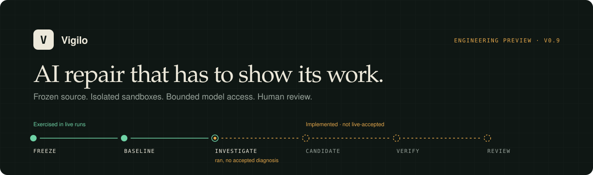
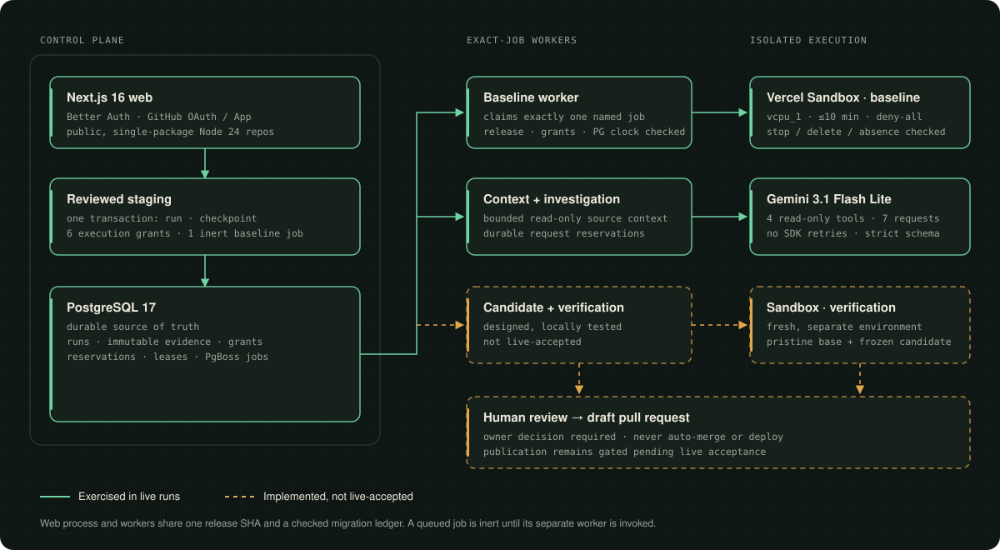

<p align="center">
  
</p>

<p align="center">
  <strong>A sandbox-first repair pipeline for failing tests in public Node.js repositories.</strong><br>
  Frozen source, isolated execution, bounded model access, and a human decision at the end.
</p>

<p align="center">
  <a href="docs/DESIGN.md">System design</a> ·
  <a href="docs/evidence/historical/README.md">Live evidence</a> ·
  <a href="#what-has-been-demonstrated">Demonstrated vs. not</a> ·
  <a href="docs/DEMO_SCRIPT.md">Three-minute walkthrough</a> ·
  <a href="#run-it-locally">Run locally</a>
</p>

> **Engineering preview, v0.9.** Vigilo has run real isolated baselines and a real bounded model investigation. It has **not** produced an autonomous AI-generated repair or an independent green verification. This README keeps those two facts side by side on purpose.

---

## The idea

Most AI coding demos end at "the model wrote a patch." That is the easy part. The hard part is deciding whether anyone should believe it.

Vigilo is built around that second problem. Every step of a repair attempt is **bound to an exact input, bounded in what it may do, and recorded as durable evidence** before the next step can start:

| Principle | How it shows up in the code |
| --- | --- |
| **Freeze the input** | Work is bound to one public commit and a source manifest. A changed repo needs a new review. |
| **Measure before guessing** | A baseline runs in a disposable Vercel Sandbox so the failure is observed, not assumed. |
| **Bound the model** | Gemini gets four read-only tools, a fixed request budget, and a strict conclusion schema. No SDK retries. |
| **Make authority explicit** | Spend and execution are gated by owner-reviewed, expiring grants. Queueing a job spends nothing. |
| **Fail closed** | Ambiguous provider outcomes are fenced, not retried. A failed cleanup is never treated as proof of absence. |
| **Keep a human in the loop** | Nothing merges or deploys automatically. Draft publication is gated. |

## The pipeline

```text
 freeze ──▶ baseline ──▶ investigate ──▶ candidate ──▶ verify ──▶ review
  live        live          live*        implemented  implemented  implemented
                                         (*no accepted diagnosis)  (not live-accepted)
```

1. **Freeze.** Select an eligible public, single-package Node.js 24 / npm repository through the GitHub App. Bind the run to one commit and manifest.
2. **Baseline.** Reconstruct the commit in a fresh `vcpu_1` Vercel Sandbox, install dependencies under a registry-only policy, switch the network to `deny-all`, read the policy back in the same session, then run typecheck, build, and tests.
3. **Investigate.** A bounded Gemini investigation inspects the failure through four scoped tools: list paths, read a file, search text, and read a sanitized baseline summary.
4. **Candidate.** Produce an exact, frozen set of changed files.
5. **Verify.** Rebuild the pristine base plus the candidate in a *different* Sandbox and run the checks again.
6. **Review.** A person reviews the diagnosis, changed files, and measured evidence. Draft-PR publication is a separate, gated step.

## Architecture

<p align="center">
  
</p>

Vigilo is a TypeScript **modular monolith**: a Next.js 16 web app (Better Auth, GitHub OAuth/App), PostgreSQL 17 with Drizzle and PgBoss, explicit one-shot workers, Gemini 3.1 Flash Lite, and Vercel Sandbox. The web process and workers share a release SHA and a checked migration ledger, but workers need separate startup and exact authority. Read [`docs/DESIGN.md`](docs/DESIGN.md) for transaction boundaries, provider budgets, and the five tradeoffs below.

## Engineering highlights

- **Enqueue is not spend.** Owner-reviewed staging creates the run, source checkpoint, six scoped execution grants, and an *inert* baseline job in one PostgreSQL transaction. A job does nothing until a separate exact-job worker claims it.
- **Exact-job workers.** A worker validates the queue, job ID, parent binding, frozen revision, release SHA, grants, and the PostgreSQL clock before claiming its one target, then exits. Leases, ownership tokens, and heartbeats fence concurrent or lost workers.
- **Network policy is verified, not assumed.** The Sandbox moves to `deny-all` and the policy is read back in the same session *before* repository scripts run. Stop, delete, and lookup-absent cleanup are all confirmed.
- **Ambiguity is permanent.** If a provider outcome is unclear, the reservation stays consumed and further execution is fenced. An ambiguous Sandbox create never authorizes a replacement.
- **Provider budgets are application-side ceilings.** Per-request serialized size, reserved input bytes, and reserved output tokens are tracked durably. They are Vigilo reservation units, not billing guarantees.
- **Untrusted by default.** Source files, objective text, and tool results are treated as data. No credentials enter the model context or Sandbox commands. Private repositories are rejected at every boundary.

## What has been demonstrated

This is the part to read closely. Everything below is recorded in the [sanitized evidence package](docs/evidence/historical/README.md).

| Capability | Status |
| --- | --- |
| Frozen-source, isolated Sandbox baseline | **Demonstrated live, twice** |
| `deny-all` network policy confirmed before repository scripts | **Demonstrated live, twice** |
| Source-integrity checks (manifest and before/after identity) | **Demonstrated live, twice** |
| Stop / delete / absence cleanup confirmed | **Demonstrated live, twice** |
| Durable job orchestration with execution grants | **Demonstrated live** |
| Bounded Gemini investigation (7 requests, 6 audited context operations) | **Ran live; no accepted diagnosis** |
| AI-generated candidate patch | Implemented, local deterministic coverage; **not live-accepted** |
| Independent green verification in a separate Sandbox | Implemented, local deterministic coverage; **not live-accepted** |
| Human review and draft-PR publication | Implemented and gated; **not live-accepted** |

### Measured baselines

Two separately approved attempts against a frozen public acceptance fixture each recorded a `test_failed` baseline. That red result is the expected **measurement**, not a failed repair and not a successful one.

| | Attempt 1 | Attempt 2 |
| --- | --- | --- |
| Install / typecheck / build | exit 0 / 0 / 0 | exit 0 / 0 / 0 |
| Tests | exit 1 | exit 1 |
| Source identity matched | yes | yes |
| Sandbox network policy | `deny-all` | `deny-all` |
| Cleanup (stop / delete / absent) | confirmed | confirmed |
| Baseline duration | 10.258 s | 10.450 s |

In attempt 2, Gemini returned seven successful provider responses and six context operations completed. The reserved, tool-free finalization did not yield an accepted structured conclusion, so the investigation ended `model_limit_exceeded`. The final response was not retained, so the exact cause is unknown. Vigilo stopped there: no candidate, no verification, no publication. The decision to halt after two attempts rather than spend on an unexplained failure was deliberate.

## Five design tradeoffs

Each choice buys a guarantee and charges for it. [`docs/DESIGN.md`](docs/DESIGN.md) covers all five in detail.

| Choice | Benefit | Cost |
| --- | --- | --- |
| Owner-reviewed, expiring grants | Queued work cannot silently authorize spend | Review can outlast the grant; attempt 1 expired before Gemini ran |
| Exact-job one-shot workers | Downstream jobs stay inert | More operator handoffs |
| Commit- and manifest-bound source | Evidence refers to one immutable input | Any change needs a new review; no private repos |
| Separate isolated Sandboxes | Baseline and verification cannot share mutable state | Provider create and cleanup can be ambiguous |
| Stateless, bounded Gemini turns | Every request is metered and audited | History grows each turn; finalization can fail |

## Limits and safety boundaries

- **Model:** an investigation is capped at 7 Gemini requests and candidate generation at 6, each serialized request at 256 KiB. Gemini SDK retries are disabled.
- **Sandbox:** one baseline and one verification Sandbox, each `vcpu_1` for at most ten minutes, plus one repair-loop iteration.
- **Account ceiling:** 16 logical operations, 205 provider attempts, 3,407,872 serialized input bytes, and 53,500 output tokens. These are reservation units, **not measured usage or a billing guarantee**.
- **Expiry and revocation:** grants expire by PostgreSQL time; revocation and lease ownership are rechecked before transport.
- **Scope:** public repositories only.

## Known limitations

- No autonomous repair, AI candidate, live green verification, or repair pull request exists yet.
- The final Gemini response is unavailable. `model_limit_exceeded` names the failed boundary, not its cause.
- Live baseline records keep phase status and exit codes, not individual test names or assertion text.
- Production hosting, managed backups, monitoring, private-repo support, and real-provider crash recovery are not validated. `/api/health` is liveness; readiness needs a matching worker and schema.
- This is an engineering portfolio release, not a commercial or production-ready service.

## Tech stack

| Layer | Choice |
| --- | --- |
| Language and runtime | TypeScript, Node.js 24, npm 11 |
| Web | Next.js 16, React 19, Better Auth, GitHub OAuth/App |
| Data and jobs | PostgreSQL 17, Drizzle ORM, PgBoss, `postgres` |
| Execution | Vercel Sandbox |
| Model | Google Gemini 3.1 Flash Lite via `@google/genai` |
| Tests | Node test runner, PGlite, PostgreSQL integration suites |

## Where to look in the code

| Interested in | Start here |
| --- | --- |
| Atomic run, grant, and job staging | [`lib/external-execution/reviewed-staging.ts`](lib/external-execution/reviewed-staging.ts) |
| Reviewed plan and fixed budgets | [`lib/external-execution/reviewed-plan.ts`](lib/external-execution/reviewed-plan.ts) |
| One-shot exact-job workers | [`worker/baseline-once.ts`](worker/baseline-once.ts), [`worker/exact-phase-once.ts`](worker/exact-phase-once.ts) |
| Baseline runner and Sandbox boundary | [`lib/repository-baselines/runner.ts`](lib/repository-baselines/runner.ts), [`src/sandbox-boundary.ts`](src/sandbox-boundary.ts) |
| Bounded Gemini investigation | [`lib/ai-investigations/runner.ts`](lib/ai-investigations/runner.ts), [`lib/ai-investigations/gemini-provider.ts`](lib/ai-investigations/gemini-provider.ts) |
| Deeper notes | [operations](docs/operations.md) · [baseline isolation](docs/baseline.md) · [candidates](docs/candidate.md) · [verification](docs/verification.md) |

## Run it locally

Use Node.js 24, npm 11, and an **isolated local PostgreSQL database**. Keep credentials in ignored, owner-restricted configuration such as `.env.local`. Never commit credentials or reuse another operator's values.

```sh
npm ci --ignore-scripts
npm run db:migrate       # only against your own disposable local database
npm run dev -- --hostname 127.0.0.1 --port 3000
```

The public landing page at `http://127.0.0.1:3000` is static and does not query the database. `GET /api/health` checks liveness. There is intentionally no self-service Start Repair action.

> **Do not run `npm run baseline`, any worker, or staging just to reproduce this README.** Live Sandbox and Gemini operations need owner-reviewed staging, unexpired grants, exact-job invocation, provider credentials, and spending approval. The [evidence package](docs/evidence/historical/README.md) is the reproducible account of the two completed live attempts and needs no new provider call.

Deterministic suites are listed under `scripts` in [`package.json`](package.json).
